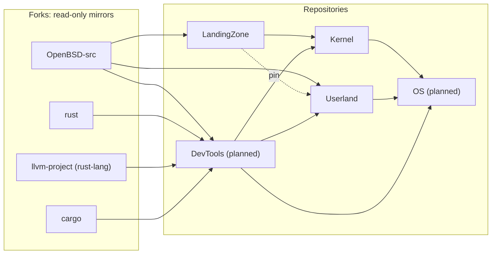

# EmiBSD Governance

The rules, decisions and plans that govern every repository of [EmiBSD](https://www.emibsd.org),
and the workspace that holds their clones.

EmiBSD is an experiment by Emilio Navarrete Lineros: the OpenBSD kernel carried into Rust,
first as a faithful file-by-file port ([LandingZone](https://github.com/EmiBSD/LandingZone)) and
then redesigned so that the compiler, not a reviewer, rules out memory errors
([Kernel](https://github.com/EmiBSD/Kernel)); then a userland written from scratch under one
contract ([Userland](https://github.com/EmiBSD/Userland)). The code is written by Claude Code
agents under written rules; the maintainer takes every decision and approves every commit.
Pre-alpha: boots only in QEMU on arm64 and runs OpenBSD's own userland unmodified.

EmiBSD is not affiliated with or endorsed by the OpenBSD project.

## The repositories

[`docs/architecture.md`](docs/architecture.md) explains every arrow. [Website](https://github.com/EmiBSD/Website)
is the public site and [`.github`](https://github.com/EmiBSD/.github) holds the organisation
profile and the community health files (security policy, contributing).

## What is here

| Path | What |
|---|---|
| [`docs/invariants.md`](docs/invariants.md) | The rules every repository obeys, with their reasons. |
| [`docs/process.md`](docs/process.md) | How the work is done: agents write, the maintainer decides and approves. |
| [`docs/architecture.md`](docs/architecture.md) | The repositories, the forks and the flows between them; the DevTools and OS plan. |
| [`docs/roadmap.md`](docs/roadmap.md) | The milestones of every repository on one page. |
| [`decisions/`](decisions/) | The decision log: one file per cross-repository decision, numbered `G-NNNN` and dated. |
| [`policies/`](policies/) | [Licences](policies/licences.md), [dependencies](policies/dependencies.md), [AI disclosure](policies/ai-disclosure.md). |
| `CLAUDE.md`, `.claude/` | The instructions the agents read when working from this directory. |

## How a decision is taken

1. An agent, or the maintainer, finds a question that crosses repositories: a name, a boundary,
   a licence, a tool, a phase.
2. The agent writes it as a proposal in `decisions/` with the options and a recommendation,
   status `proposed`. It never takes the decision.
3. The maintainer decides, in conversation; the file records the decision, its date and its
   consequences, status `accepted`.
4. The repositories it binds cite it by number in their rules, and follow it.
5. A later decision that replaces it sets it to `superseded` and points forward; nothing is
   deleted from the log.

Repository-internal decisions stay in that repository's own log (Kernel's `docs/PHASE2.md`,
Userland's `docs/PROGRAM.md`); this log is for what crosses them.

## Licence

ISC, see [LICENSE](LICENSE).
