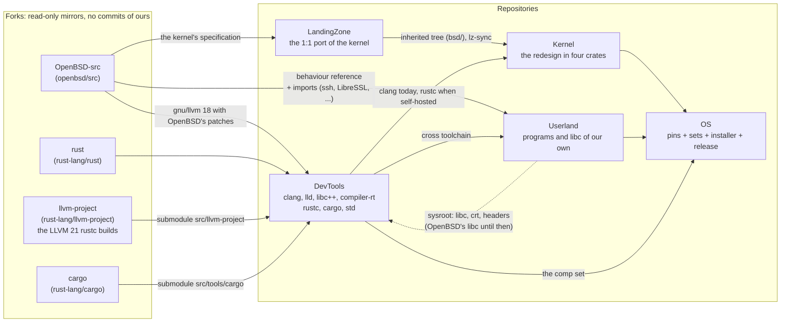
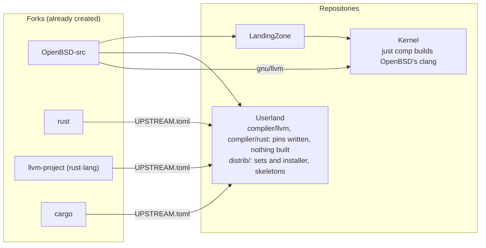
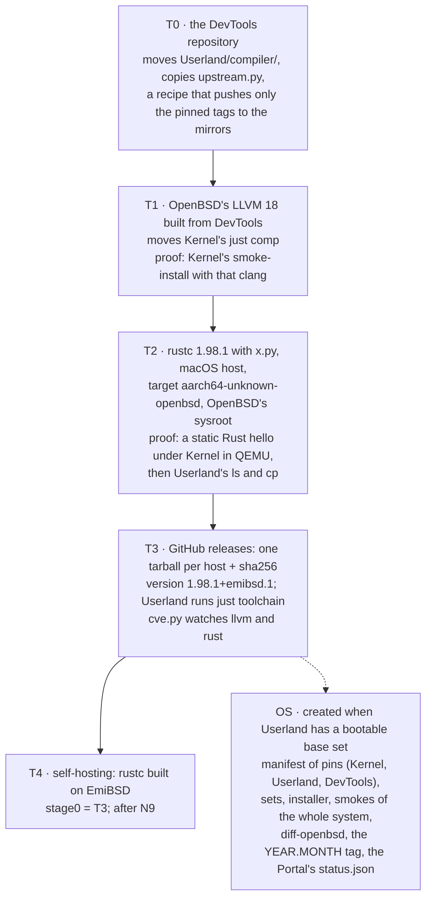

# Repositories and the flows between them

The organisation [github.com/EmiBSD](https://github.com/EmiBSD) holds two kinds of
repository: **forks**, read-only mirrors of the upstreams the project builds from, and
**repositories**, where the work happens. Working draft of 2026-10-31; DevTools and OS are
proposed, not yet decided (the open decisions are at the end).

## Target layout

Governance and Portal are not in the picture: Governance binds every repository and Portal
publishes their state; neither feeds a build.

### Every arrow

| From | To | What flows | Why |
|---|---|---|---|
| OpenBSD-src | LandingZone | the C under `sys/`, read-only, at the pin | the specification of the port |
| OpenBSD-src | Userland | manuals and code as the behaviour reference; the imported programs' sources | written programs come from a specification written against OpenBSD; imported ones are compiled from it |
| OpenBSD-src | DevTools | `gnu/llvm`, `gnu/usr.bin/clang`, `gnu/lib/libcxx*`, `libclang_rt`, `libcompiler_rt` | the system's clang, lld and libc++ are OpenBSD's LLVM 18 with its patches (RETGUARD, `-fret-clean`, the fixed X18, BTI and PAC defaults) |
| rust, llvm-project, cargo | DevTools | rust-lang/rust at the pinned stable tag with its two submodules | rustc 1.98.1 needs LLVM 21 and builds the one in its submodule; OpenBSD's 18 stays for the C. Two LLVMs, decided 2026-10-23 |
| LandingZone | Kernel | the tree at `lz-origin`, then every commit triaged as `lz-sync:` | Kernel redesigns what LandingZone ported; LandingZone never learns Kernel exists |
| DevTools | Userland | the cross toolchain for `aarch64-unknown-openbsd` | Userland's programs are built with it, on the host first |
| DevTools | Kernel | clang today (`just comp`, for the inherited userland the smokes boot); rustc once EmiBSD hosts its own build | the kernel itself needs only a stock stable toolchain, its target is `aarch64-unknown-none-softfloat` |
| Userland | DevTools (dotted) | the sysroot: libc, crt, headers | a binary the toolchain produces needs a libc; `std`'s rlibs are compiled without one, so the cycle breaks there. Until Userland has `lib/libc`, the sysroot is the libc of the OpenBSD sets Kernel already boots |
| Kernel, Userland, DevTools | OS | a kernel image, the installed tree, the comp set | OS assembles and releases; it builds nothing of its own |

## Today

The pins are consistent: `Userland/compiler/rust/UPSTREAM.toml` names the `llvm-project` and
`cargo` commits that rust's tag 1.98.1 carries as submodules, and both exist in the mirrors.

- **DevTools** is `Userland/compiler/` and Kernel's `just comp` moved to their own repository.
- **OS** is the images and ISO of Kernel's xtask, `Userland/distrib/` and `regress/harness`
  gathered in one place.

## Proposed order

T2 is the day EmiBSD runs code of its own on a kernel of its own; it deserves a devlog entry.

## Rules the layout implies

- Forks are mirrors: no commit of ours lands on them, only the upstream tags the pins name.
  Patches live in the consuming repository's `patches/`, each with its reason.
- DevTools knows nothing of Kernel's or Userland's internals; it takes a sysroot as an input
  and publishes artifacts with checksums. Nothing it ships is written code: imported class
  only, plus build glue.
- OS builds nothing; it pins, assembles, boots and tags.

## Open decisions (the maintainer's)

1. Name: DevTools or Toolchain. If lldb is in, DevTools; if only compilers and `std`, Toolchain.
2. Scope of DevTools: clang, lld, libc++, compiler-rt, rustc, cargo, std. lldb?
3. `compiler/` leaves Userland entirely; `distrib/sets` lists the comp set from DevTools' artifacts.
4. Kernel's `just comp` moves to DevTools now.
5. Hosts: macOS arm64 first; Linux x86_64 only if Userland's CI needs it; arm64 OpenBSD at T4.
6. OS now or at the first release; its name: OS, Release or System.
