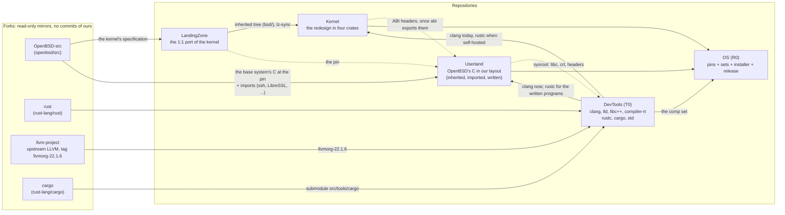
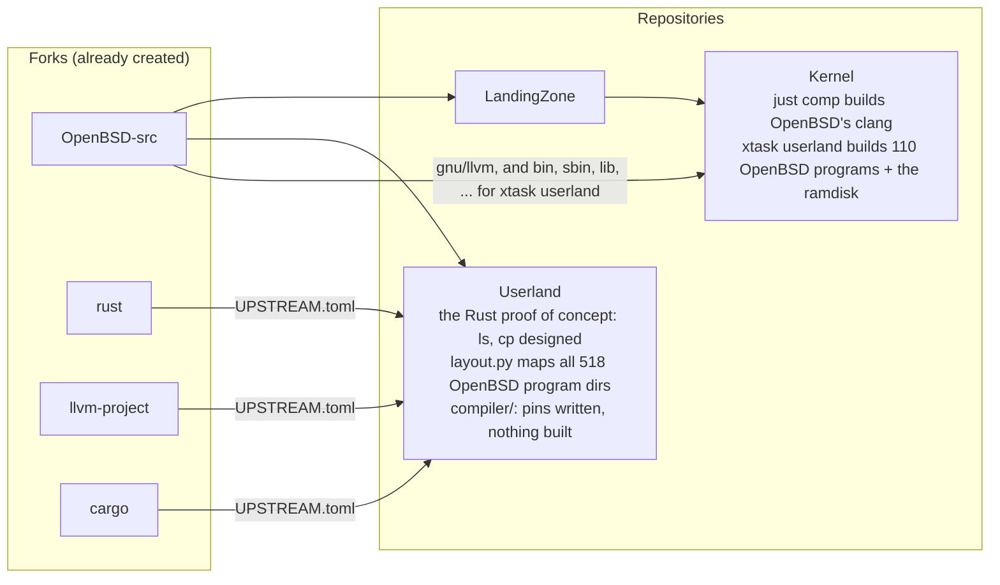
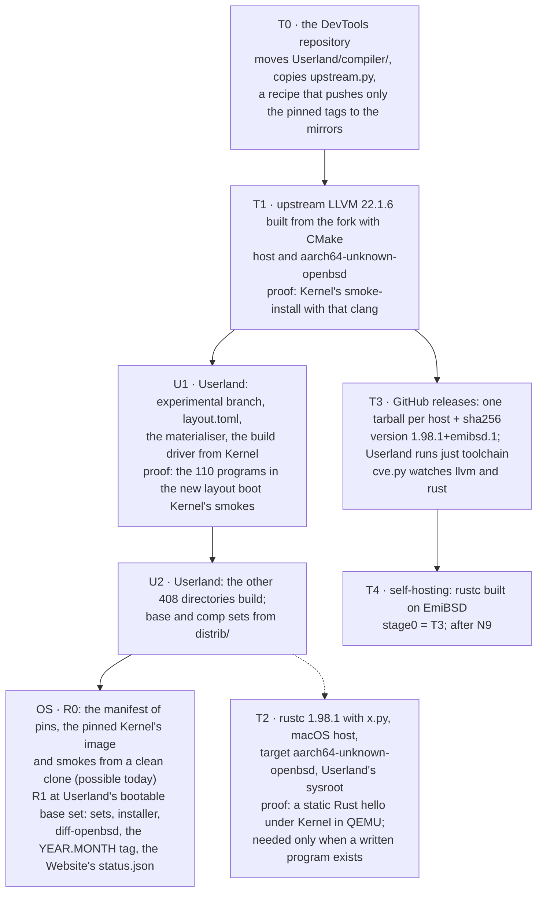

# Repositories and the flows between them

The organisation [github.com/EmiBSD](https://github.com/EmiBSD) holds two kinds of
repository: **forks**, read-only mirrors of the upstreams the project builds from, and
**repositories**, where the work happens. Working draft of 2026-10-31; DevTools and OS
(G-0012) and Userland's turn to inherited C (G-0013) are proposed, not yet decided (the open
decisions are at the end).

## Target layout

Governance and Website are not in the picture: Governance binds every repository and Website
publishes their state; neither feeds a build.

### Every arrow

| From | To | What flows | Why |
|---|---|---|---|
| OpenBSD-src | LandingZone | the C under `sys/`, read-only, at the pin | the specification of the port |
| OpenBSD-src | Userland | the base system's C (`bin`, `sbin`, `usr.bin`, `usr.sbin`, `libexec`, `lib`, `include`, `etc`, `share/mk`) at LandingZone's pin, placed in our layout by `layout.toml`; the imported programs' sources | G-0013: the code is OpenBSD's, the order is ours; `gnu/` excluded |
| LandingZone | Userland (dotted) | the pin, nothing else | one owner of the pin: it fixes the ABI the kernel implements; Userland refuses to build if its pin differs from Kernel's. LandingZone holds no userland code |
| Kernel | Userland (dotted, later) | the ABI headers (`sys/*.h`, `machine/*.h`) exported from the `abi` crate | today they come from OpenBSD's `sys/` at the same pin, byte-identical by invariant 2 |
| rust, llvm-project, cargo | DevTools | rust-lang/rust at the pinned stable tag with its `cargo` submodule; upstream LLVM at `llvmorg-22.1.6` | the only inputs of DevTools; nothing comes from OpenBSD (G-0015). One LLVM, built with its own CMake, for the C and for rustc's backend |
| LandingZone | Kernel | the tree at `lz-origin`, then every commit triaged as `lz-sync:` | Kernel redesigns what LandingZone ported; LandingZone never learns Kernel exists |
| DevTools | Userland | clang, lld and libc++ from upstream LLVM 22.1.6; the Rust cross toolchain for `aarch64-unknown-openbsd` when a written program exists | one toolchain for the whole base system; what OpenBSD's build glue passed to its own patched clang is adapted in Userland, where that C is built |
| DevTools | Kernel | clang today (`just comp`, for the inherited userland the smokes boot); rustc once EmiBSD hosts its own build | the kernel itself needs only a stock stable toolchain, its target is `aarch64-unknown-none-softfloat` |
| Userland | DevTools (dotted) | the sysroot: libc, crt, headers | a binary the toolchain produces needs a libc; with G-0013 it is OpenBSD's libc from Userland's own tree from day one. `std`'s rlibs are compiled without one, so the cycle breaks there |
| Kernel, Userland, DevTools | OS | a kernel image, the installed tree, the comp set | OS assembles and releases; it builds nothing of its own |

## Today

The pins are consistent: `Userland/compiler/rust/UPSTREAM.toml` names the `llvm-project` and
`cargo` commits that rust's tag 1.98.1 carries as submodules, and both exist in the mirrors.

- **DevTools** is the toolchains from the forks alone: upstream LLVM and Rust; nothing of
  OpenBSD enters it (G-0015). Kernel's `just comp` stays Kernel's.
- **Userland after G-0013** is Kernel's `xtask userland` and `bsdmake.rs` given a home, with
  the C placed where `layout.py` already says, and the Rust proof of concept parked in the
  `experimental` branch.
- **OS** is the images and ISO of Kernel's xtask, `Userland/distrib/` and `regress/harness`
  gathered in one place.

## Proposed order

U1 is the day the system boots from Userland's tree instead of Kernel's build; T2 is the day
a program written for EmiBSD runs on its kernel. Both deserve a devlog entry.

## Rules the layout implies

- Forks are mirrors: no commit of ours lands on them, only the upstream tags the pins name.
  Patches live in the consuming repository's `patches/`, each with its reason.
- DevTools knows nothing of Kernel's or Userland's internals; it takes a sysroot as an input
  and publishes artifacts with checksums. Nothing it ships is written code: imported class
  only, plus build glue.
- OS builds nothing; it pins, assembles, boots and tags.

## Open decisions (the maintainer's)

1. ~~Name~~: DevTools, decided 2026-10-31; the repository exists.
2. Scope of DevTools: clang, lld, libc++, compiler-rt, rustc, cargo, std. lldb?
3. `compiler/` leaves Userland entirely; `distrib/sets` lists the comp set from DevTools' artifacts.
4. ~~Kernel's `just comp` moves to DevTools now~~: it stays Kernel's; DevTools builds upstream LLVM with CMake (G-0015, 2026-10-31).
5. Hosts: macOS arm64 first; Linux x86_64 only if Userland's CI needs it; arm64 OpenBSD at T4.
6. ~~OS now or at the first release~~: now, as `OS`, decided 2026-10-31; the repository exists.
7. G-0013's four: the inherited C committed or fetched; Kernel keeps its own userland build
   until N9; Perl in or out; Userland's milestone letter and its first milestone.
