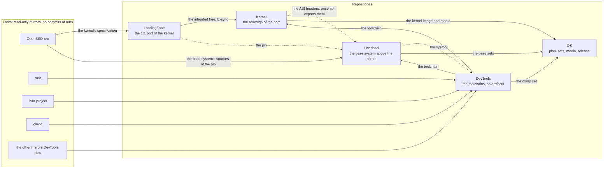

# Repositories and the flows between them

The organisation [github.com/EmiBSD](https://github.com/EmiBSD) holds two kinds of
repository: **forks**, read-only mirrors of the upstreams the project builds from, and
**repositories**, where the work happens. This page is the view across them: which feeds
which, and why. What happens inside a repository is described in that repository, not here.
State as of 2026-10-31.

## The layout

Governance and Website are not in the picture: Governance binds every repository and Website
publishes their state; neither feeds a build.

## Every arrow

| From | To | What flows | Why |
|---|---|---|---|
| OpenBSD-src | LandingZone | the C under `sys/`, read-only, at the pin | the specification of the port |
| OpenBSD-src | Userland | the base system's sources at LandingZone's pin | the system EmiBSD runs above its kernel starts from OpenBSD's, at the same pin as the kernel |
| LandingZone | Userland (dotted) | the pin, nothing else | one owner of the pin: it fixes the ABI the kernel implements. LandingZone holds no userland code |
| Kernel | Userland (dotted, later) | the ABI headers exported from the `abi` crate | today they come from OpenBSD's `sys/` at the same pin, byte-identical by invariant 2 |
| the forks of rust-lang and LLVM | DevTools | the pinned upstream tags | the only inputs of DevTools; nothing comes from OpenBSD |
| LandingZone | Kernel | the tree at `lz-origin`, then every commit triaged as `lz-sync:` | Kernel redesigns what LandingZone ported; LandingZone never learns Kernel exists |
| DevTools | Userland, Kernel | the toolchain, by pin and checksum | one toolchain for the whole system |
| Userland | DevTools (dotted) | the sysroot: libc, crt, headers | a binary the toolchain produces needs a libc; `std`'s rlibs are compiled without one, so the cycle breaks there |
| Kernel, Userland, DevTools | OS | a kernel image, the base sets, the comp set | OS assembles and releases; it builds nothing of its own |

## Rules the layout implies

- Forks are mirrors: no commit of ours lands on them, only the upstream tags the pins name.
  Patches live in the consuming repository, each with its reason.
- Every repository reads in one direction (`docs/invariants.md`, 7): LandingZone never names
  Kernel; DevTools knows nothing of its consumers' internals and takes a sysroot as an input;
  OS builds nothing, it pins, assembles, boots and tags.
- One OpenBSD pin, LandingZone's: Kernel, Userland and OS state it and refuse to build against
  another.
- A repository's plan, milestones, open questions and internal decisions live in that
  repository. This page is updated by reading them; when they disagree, the repository is right.
