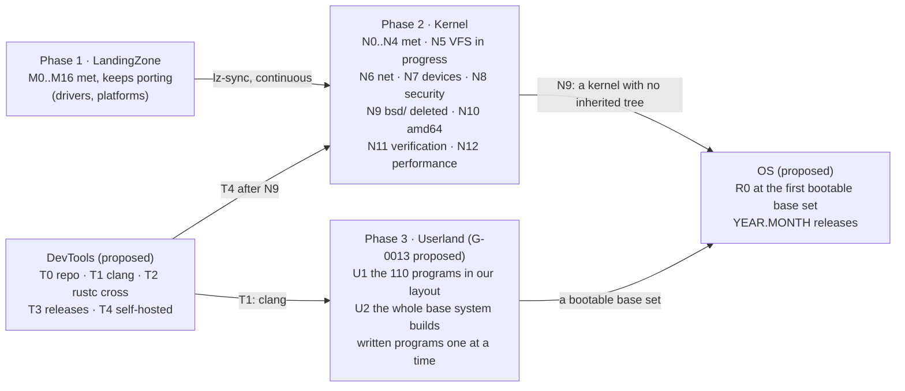

# Roadmap, every repository on one page

State as of 2026-10-31. Each repository keeps the authoritative detail (LandingZone's
`README.md`, Kernel's `docs/ROADMAP.md` and `docs/STATUS.md`, Userland's `catastro.md`,
Portal's `_data/status.json`); this page is the view across them.

## Phase 1: LandingZone (M)

The faithful port. M0 to M16 met: boot on both architectures, uvm, network to IPv6 and
WireGuard, storage to softraid and NFS, MP, USB and audio, installable with its own efiboot and
the base and comp sets. It keeps porting what OpenBSD adds and what the system still lacks;
every commit is triaged into Kernel as `lz-sync:`.

## Phase 2: Kernel (N)

| Milestone | Scope | State |
|---|---|---|
| N0 Bootstrap | lineage records, tooling, the `unsafe` budget | met 2026-10-09 |
| N1 Leaves | libkern, libz, the crypto primitives | met 2026-10-09 |
| N2 Foundations | the `kernel`, `abi`, `hal` crates, the runtime, pipe(2) | met 2026-10-16 |
| N3 Memory | uvm into `kernel::vm`, the pmaps into `hal` | met 2026-10-18 |
| N4 Processes | processes, descriptors, kqueue, scheduler, signals, tty, sysctl | met 2026-10-24 |
| N5 VFS | buffer cache, VFS, ufs, ffs, ext2fs, msdosfs, cd9660, udf, tmpfs, fuse | in progress (N5.5a) |
| N6 Network | interfaces, routing, IPv4, IPv6, sockets, nfs | |
| N7 Devices | the driver model, then every bus and driver | |
| N8 Security | pf, IPsec, WireGuard, pledge, unveil, exec, crypto | |
| N9 Close | the last of the LandingZone tree deleted, on arm64 | |
| N10 amd64 | the frozen tree brought up to date | |
| N11 Verification | semantic `unsafe` count, idiomaticity, OpenBSD's regress | |
| N12 Performance | the slowdowns left open after N3 | started early |

## Phase 3: Userland (U, proposed in G-0013)

Until G-0013 is decided, Userland is the Rust proof of concept: `ls` and `cp` designed on the
shared crates `cli` and `sys`, the rest planned in `catastro.md`. Under G-0013 it becomes
OpenBSD's base system in our layout, three classes (inherited, imported, written), and its
milestones are: U1 the 110 programs Kernel builds today, in the new layout, booting Kernel's
smokes (needs DevTools T1); U2 the whole base system builds, `base` and `comp` sets from
`distrib/` (OS is created); then written programs one at a time, each needing DevTools T2.

## DevTools (T, proposed)

T0 the repository, T1 OpenBSD's LLVM, T2 rustc cross for `aarch64-unknown-openbsd`, T3
releases, T4 self-hosted. Detail in `docs/architecture.md`.

## OS (R, proposed)

Created at the first bootable base set. Each release is a `YEAR.MONTH` tag over a manifest of
pins, with the sets, the media, the smokes of the whole system and `diff-openbsd` green.

## Portal

Follows the rest: `status.json` at every milestone, a devlog entry at every close and at T2.
