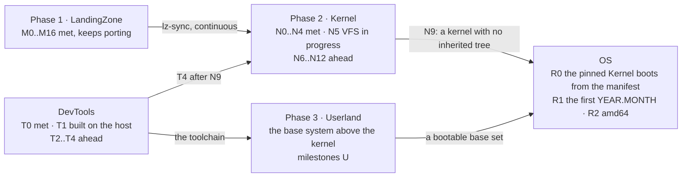

# Roadmap, every repository on one page

State as of 2026-10-31. Each repository keeps the authoritative detail (LandingZone's
`README.md`, Kernel's `docs/ROADMAP.md` and `docs/STATUS.md`, Userland's `catastro.md`,
DevTools' `CLAUDE.md`, OS's `docs/RELEASE.md`, Website's `_data/status.json`); this page is
the view across them and is updated by reading them.

## Phase 1: LandingZone (M)

The faithful port. M0 to M16 met: boot on both architectures, uvm, network to IPv6 and
WireGuard, storage to softraid and NFS, MP, USB and audio, installable with its own efiboot and
the base and comp sets. It keeps porting what OpenBSD adds and what the system still lacks;
every commit is triaged into Kernel as `lz-sync:`.

## Phase 2: Kernel (N)

| Milestone | Scope | State |
|---|---|---|
| N0 Bootstrap | lineage records, tooling, the `unsafe` budget | met 2026-10-09 |
| N1 Leaves | libkern, libz, the crypto primitives | met 2026-10-09 |
| N2 Foundations | the `kernel`, `abi`, `hal` crates, the runtime, pipe(2) | met 2026-10-16 |
| N3 Memory | uvm into `kernel::vm`, the pmaps into `hal` | met 2026-10-18 |
| N4 Processes | processes, descriptors, kqueue, scheduler, signals, tty, sysctl | met 2026-10-24 |
| N5 VFS | buffer cache, VFS, ufs, ffs, ext2fs, msdosfs, cd9660, udf, tmpfs, fuse | in progress (N5.5a) |
| N6 Network | interfaces, routing, IPv4, IPv6, sockets, nfs | |
| N7 Devices | the driver model, then every bus and driver | |
| N8 Security | pf, IPsec, WireGuard, pledge, unveil, exec, crypto | |
| N9 Close | the last of the LandingZone tree deleted, on arm64 | |
| N10 amd64 | the frozen tree brought up to date | |
| N11 Verification | semantic `unsafe` count, idiomaticity, OpenBSD's regress | |
| N12 Performance | the slowdowns left open after N3 | started early |

## Phase 3: Userland (U)

The base system above the kernel. Its plan, classes of program and milestones are Userland's
(`catastro.md`, `docs/PROGRAM.md`, its README). What the rest waits for: a bootable `base`
set, which is OS's R1.

## DevTools (T)

T0 the repository, met 2026-10-31. T1 the C toolchain, built and checked on the host the same
day, its QEMU proof pending. T2 the Rust toolchain. T3 releases as artifacts. T4 self-hosted,
after Kernel's N9. Detail in DevTools.

## OS (R)

Created 2026-10-31. R0: the manifest of pins and the pinned Kernel's image and smokes from a
clean clone. R1 at Userland's first bootable `base` set: the sets, the media, `diff-openbsd`,
the first `YEAR.MONTH` tag. R2: amd64 after N10. Each release is a tag over a manifest commit
whose assembled pins boot and pass.

## Website

Follows the rest: `status.json` at every milestone, a devlog entry at every close.
